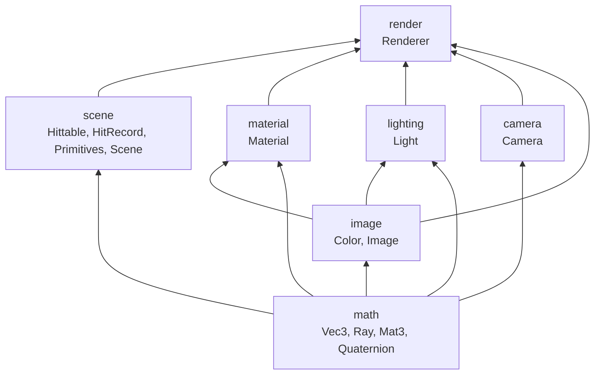

# C++20 Gaming & Graphics Engineering Standards and Conventions

This document defines the coding standards, architectural conventions, and performance discipline for **LightRail** and future C++20 graphics, simulation, and game-engine modules in this repository.

---

## Table of Contents

1. [Core Engineering Philosophy](#1-core-engineering-philosophy)
2. [Project Layout & Header Hygiene](#2-project-layout--header-hygiene)
3. [Naming & Formatting Conventions](#3-naming--formatting-conventions)
4. [Modern C++20 Standards & Idioms](#4-modern-c20-standards--idioms)
5. [Hot-Path Performance & Data-Oriented Design](#5-hot-path-performance--data-oriented-design)
6. [Graphics Math & Numerical Precision](#6-graphics-math--numerical-precision)
7. [Memory & Ownership Semantics](#7-memory--ownership-semantics)
8. [Concurrency & Deterministic Rendering](#8-concurrency--deterministic-rendering)
9. [Error Handling & Assertions](#9-error-handling--assertions)
10. [Documentation & Comments](#10-documentation--comments)
11. [Testing, Build Hygiene & Static Analysis](#11-testing-build-hygiene--static-analysis)

---

## 1. Core Engineering Philosophy

- **Zero External Dependencies**: Core engine modules use only the C++20 standard library (`CMAKE_CXX_EXTENSIONS OFF`). Do not introduce third-party dependencies into `lightrail_core`.
- **Clarity Meets Throughput**: Code must express mathematical and physical intent clearly while respecting CPU cache, inlining, and branch-prediction realities in inner loops.
- **Explicit Contracts**: Preconditions (e.g., unit-length normals, valid `[t_min, t_max]` intervals, radian angles) must be documented in headers and verified with debug assertions.
- **Deterministic by Default**: Given identical inputs and RNG seeds, renders and unit tests must produce reproducible results across runs and thread counts.

---

## 2. Project Layout & Header Hygiene

### Directory Structure
- Public headers live in `include/lightrail/<subsystem>/<name>.hpp`.
- Implementation files live in `src/<subsystem>/<name>.cpp`.
- Unit tests live in `tests/test_<area>.cpp`.
- Subsystems (`math`, `image`, `scene`, `material`, `lighting`, `camera`, `render`) should maintain clean, acyclic dependencies:



### Header Rules
- **Include Guards**: Always start headers with `#pragma once`.
- **Include-What-You-Use (IWYU)**: Every `.hpp` and `.cpp` must directly `#include` the headers for every symbol it uses; never rely on transitive includes.
- **Forward Declarations**: Prefer lightweight forward declarations in headers when full definitions are not needed (e.g., `#include <iosfwd>` for `std::ostream&` and `class Mat3;` in `quaternion.hpp`).
- **Include Ordering**: Group `#include` directives in the following order, sorted alphabetically within each group:
  1. Matching header (in `.cpp` files only): `#include "lightrail/math/vec3.hpp"`
  2. C++ standard library headers: `#include <cmath>`, `#include <optional>`, `#include <vector>`
  3. Project headers: `#include "lightrail/math/constants.hpp"`
- **Namespaces**: Wrap all library declarations in `namespace lightrail { ... } // namespace lightrail`. Do **not** indent code inside the top-level namespace. Never place `using namespace ...;` at file scope in any header.

---

## 3. Naming & Formatting Conventions

### Naming Quick Reference

| Entity | Convention | Examples |
| :--- | :--- | :--- |
| Files | `snake_case.hpp` / `snake_case.cpp` | `hit_record.hpp`, `algebra_concepts.hpp` |
| Types (`struct`, `class`, `enum class`, `using`, `concept`) | `PascalCase` | `Vec3`, `Point3`, `HitRecord`, `MaterialType`, `VectorSpace` |
| Enumerators | `PascalCase` | `MaterialType::Phong`, `MaterialType::Dielectric` |
| Functions, methods, parameters, local variables | `snake_case` | `length_squared()`, `unit_vector()`, `etai_over_etat` |
| Public `struct` / aggregate data fields | `snake_case` | `x`, `y`, `z`, `samples_per_pixel`, `albedo` |
| Private `class` data members | `snake_case_` (trailing underscore) | `u_`, `v_`, `w_`, `viewport_upper_left_` |
| Compile-time constants | `kPascalCase` | `kPi`, `kEpsilon`, `kInfinity`, `kDeg90` |
| Macros (avoid unless required) | `LIGHTRAIL_UPPER_SNAKE_CASE` | `LIGHTRAIL_ASSERT(...)` |

### Formatting Rules
- **Indentation**: 4 spaces per level; hard tabs (`\t`) are prohibited.
- **Braces**: K&R style (opening `{` on the same line for types, functions, and control flow). Always use braces for multi-line control blocks and prefer them for single-line `if`/`for`/`while` statements to prevent dangling bugs.
- **Line Length**: Soft limit of 100 characters; hard limit of 120 characters.
- **Pointers & References**: Attach `*` and `&` to the type (`const Vec3& v`, `const Hittable* obj`), and declare only one variable per declaration line.
- **Spacing**: Single space after control keywords (`if (x > 0.0)`), single space around binary operators, no spaces inside parentheses.

---

## 4. Modern C++20 Standards & Idioms

- **`constexpr` and `noexcept`**: Mark pure math constructors, static factories, accessors, and non-throwing value operations `constexpr` and `noexcept`.
- **`[[nodiscard]]`**: Apply `[[nodiscard]]` to pure functions and factories whose return values should never be silently discarded (e.g., `unit_vector()`, `reflect()`, `refract()`, `length()`, `length_squared()`, `approx_equal()`, `Mat3::inverse()`).
- **Brace Initialization**: Use `{}` for default member initializers (e.g., `double x{0.0};`, `int max_depth{5};`) to guarantee initialization and catch narrowing conversions.
- **Scoped Enums**: Always use `enum class` rather than unscoped `enum`.
- **Rule of Zero / Rule of Five**: Prefer types that need no custom destructor, copy, or move operations (Rule of Zero). If a class has a `virtual` destructor (`virtual ~Hittable() = default;`), explicitly consider its copy/move semantics.
- **C++20 Concepts & Standard Vocabulary Types**:
  - Use C++20 `concept` constraints (as in `algebra_concepts.hpp`) instead of SFINAE/`std::enable_if`.
  - Use `std::optional<T>` for fallible value returns (e.g., `std::optional<Mat3> inverse() const`).
  - Use `std::span<const T>` and `std::string_view` for non-owning contiguous views.
  - Use defaulted C++20 equality (`constexpr bool operator==(const Vec3&) const noexcept = default;`) where exact structural equality is meaningful.

```cpp
// Good: constexpr, noexcept, [[nodiscard]], brace-initialized defaults
struct Vec3 {
    double x{0.0};
    double y{0.0};
    double z{0.0};

    constexpr Vec3() noexcept = default;
    constexpr Vec3(double x, double y, double z) noexcept : x(x), y(y), z(z) {}

    [[nodiscard]] constexpr double length_squared() const noexcept {
        return x * x + y * y + z * z;
    }

    constexpr bool operator==(const Vec3&) const noexcept = default;
};
```

---

## 5. Hot-Path Performance & Data-Oriented Design

Ray tracers and game engines spend >90% of execution time in tight inner loops (ray-primitive intersection, BVH traversal, vector math, shading). Design for the hardware:

### Header Inlining for Micro-Math
- **Do** define trivial, high-frequency math operations (`Vec3`, `Ray`, `Color`, `Quaternion` arithmetic, `dot`, `cross`, `lerp`, `reflect`, `length_squared`) as `inline constexpr` in headers. Without LTO, out-of-line `.cpp` definitions force cross-TU function calls and prevent auto-vectorization.
- **Keep out-of-line** in `.cpp` files: heavy algorithms (`.obj` parsing, `Image::save_bmp`, `Mat3::inverse`, `Renderer::render`), I/O (`operator<<`), and stateful RNG routines.

### Zero Heap Allocations on Hot Paths
- **Never** allocate dynamic memory (`new`, `std::make_shared`, `std::vector` growth, `std::string` construction) inside `hit()`, `scatter()`, `trace_ray()`, `calculate_shading()`, or per-pixel loops.
- Pre-allocate buffers (`Image::pixels`, scratch arrays, BVH node pools) once before rendering begins.

### Cache Locality & Memory Layout
- Prefer flat, contiguous containers (`std::vector<Triangle>`, `std::vector<BVHNode>`) over pointer-chasing hierarchies (`std::vector<std::shared_ptr<Hittable>>`) as scene complexity grows.
- Order struct fields from largest alignment to smallest alignment to minimize padding in frequently iterated records (e.g., `HitRecord`, `Material`, `Light`).
- Avoid `virtual` dispatch inside the innermost triangle/BVH traversal loops when scaling to large meshes; group homogeneous primitives (e.g., `Mesh` iterating contiguous `Triangle`s).

### Parameter Passing
- Pass built-in scalars (`double`, `int`, `bool`) and trivial view types (`std::string_view`, `std::span`) **by value**.
- Pass small math types (`Vec3`, `Color`, `Ray`) by `const T&` (or by value if profiling confirms register passing benefits on target ABI); stay consistent within each header.
- Pass larger aggregates (`HitRecord`, `Scene`, `Camera`, `Image`) by `const T&` (or `T&` for out-parameters).

---

## 6. Graphics Math & Numerical Precision

### Coordinate System & Units
- **Handedness**: Right-handed coordinate system (`+X` right, `+Y` up, `-Z` camera forward; `cross(unit_x, unit_y) == unit_z`).
- **Angles**: All internal math functions (`Mat3::rotation_*`, `Quaternion::from_axis_angle`, trigonometric calls) accept **radians**. Public configuration APIs that accept degrees must state `_degrees` in the parameter name (e.g., `vfov_degrees`) and convert via `deg_to_rad()`.

### Floating-Point Hygiene
- **Avoid unnecessary `std::sqrt()`**: Use `length_squared()` instead of `length()` for distance comparisons, sphere rejection sampling, and thresholds.
- **Tolerance Comparisons**: Never compare computed floating-point results with exact `==` in geometric tests; use `approx_equal(a, b, epsilon)` with `kEpsilon` (or an explicit scale-appropriate tolerance).
- **Degenerate & Near-Zero Guards**:
  - Guard against zero-length vectors before normalizing (`near_zero()` / length checks).
  - Use a positive `t_min` ray bias (e.g., `1e-4` to `1e-3`) for secondary/shadow rays to prevent self-intersection (shadow acne).
  - Sanitize `NaN` / `Inf` radiance values (e.g., via `std::isfinite`) before gamma correction and pixel quantization so a single bad sample cannot corrupt an entire pixel.
- **Unit-Vector Preconditions**: Explicitly document and `assert` when a function requires unit-length inputs (e.g., `reflect(v, normal)`, `refract(uv, n, etai_over_etat)`).

### `double` vs. `float` Policy
- **LightRail Default (`double`)**: LightRail currently uses `double` (64-bit IEEE-754) across its math, geometry, and abstract-algebra types for maximum analytical precision and reduced numerical drift during educational derivations and intersection math.
- **When to Switch to `float` (Real-Time / Game-Engine Profile)**:
  - If LightRail evolves toward a real-time renderer, BVH-accelerated large-mesh engine, or SIMD/GPU-aligned pipeline, migrating hot-path geometry/math to 32-bit `float` (optionally via a central `using Real = float;` alias) is strongly recommended:
    - **2x cache density** (more vertices, BVH nodes, and colors fit in L1/L2 cache).
    - **2x SIMD throughput** (4x `float` per 128-bit SSE register / 8x per AVX2 register vs. 2x / 4x for `double`).
    - **Direct GPU parity** with HLSL/GLSL/WGSL shaders.
  - When using `float`, tighten epsilon discipline (`kEpsilon = 1e-5f` for geometric checks, `1e-3f` for ray origin bias) and consider keeping `double` only for large world-space coordinates or high-precision analytical unit tests.

---

## 7. Memory & Ownership Semantics

- **Value Semantics First**: Store objects directly by value (`std::vector<Light>`, `Material`, `Vec3`) whenever polymorphism is unnecessary.
- **No Raw Owning Pointers**: Never use owning `new` or `delete`.
- **Smart Pointers**:
  - Prefer `std::unique_ptr<T>` (`std::make_unique`) for exclusive ownership.
  - Use `std::shared_ptr<T>` (`std::make_shared`) only when ownership is genuinely shared across multiple scene nodes (e.g., shared `Material`, textures, or instanced `Mesh` data). Avoid copying `std::shared_ptr` inside hot loops (atomic ref-count traffic hurts multithreaded scaling).
- **Non-Owning Observers**: Use `const T&` / `T&` when non-null, or non-owning `const T*` / `T*` when nullable.

---

## 8. Concurrency & Deterministic Rendering

- **Immutable Render State**: During `Renderer::render()`, the `Scene` and initialized `Camera` must be treated as strictly read-only (`const`) across all worker threads.
- **Thread-Safe RNG**:
  - Never share an unsynchronized global PRNG across threads (data race + non-determinism).
  - Use either `thread_local` PRNG instances (seeded deterministically per thread/tile) or pass an explicit lightweight RNG state (e.g., PCG32 / xoshiro / `std::mt19937_64`) into sampling functions.
- **Avoid False Sharing**:
  - Partition work into independent scanlines or 2D tiles (e.g., 16x16 or 32x32 pixels) so worker threads write to disjoint regions of `Image::pixels`.
  - Keep per-thread counters/accumulators local to each thread and merge them only when the thread joins.

---

## 9. Error Handling & Assertions

Separate **programmer bugs** from **expected runtime failures** and **cold vs. hot paths**:

| Situation | Mechanism | Example |
| :--- | :--- | :--- |
| Programmer bug / violated precondition (debug) | `assert(...)` | Non-unit normal passed to `reflect()`, `t_min > t_max`, out-of-bounds `Image::at(x, y)` |
| Expected mathematical failure (hot or warm path) | `std::optional<T>` or `bool` | `Mat3::inverse()` on singular matrix; `Hittable::hit()` miss |
| Expected I/O or parsing failure (cold path) | `bool` or `std::optional` / error message | `Image::save_bmp()`, `.obj` file not found |
| Unimplemented TDD scaffold stubs / fatal startup errors | `std::logic_error` / `std::runtime_error` | LightRail's `Not implemented: ...` stubs |

- **No Exceptions on Hot Paths**: Never throw or catch exceptions inside per-ray or per-pixel rendering loops.

---

## 10. Documentation & Comments

- **Public Interfaces**: Document all public classes, structs, methods, and free functions with Javadoc-style Doxygen blocks (`/** ... */`) using `@file`, `@brief`, `@param`, `@return`, and `@pre`.
- **Mathematical Contracts & MathJax**: Include formulas using Doxygen MathJax syntax (`@f$ \mathbf{P}(t) = \mathbf{O} + t\mathbf{D} @f$`) and preconditions (unit length, domain bounds) directly in header Doxygen blocks.
- **Educational Links**: Attach authoritative, free references via `@see [Topic Title](https://...)` (e.g., *Ray Tracing in One Weekend*, *PBRT v4*, *Scratchapixel*, *Wikipedia*, *cppreference*) so headers double as a self-contained study guide.
- **HTML Diagrams**: Store custom geometric/optical SVG diagrams in `docs/diagrams/` and embed them with `@image html <diagram>.svg "Caption"`. Doxygen is configured in `docs/Doxyfile.in` (built via `cmake --build build --target docs`) with MathJax and auto-detected Graphviz DOT (`HAVE_DOT = YES`) for interactive class and dependency graphs.
- **Implementation Comments**: Explain *why* a choice was made (numerical stability, shadow-acne offset, branchless optimization), not *what* self-evident code already says. Do not duplicate header Doxygen blocks above `.cpp` definitions.

---

## 11. Testing, Build Hygiene & Static Analysis

### Compiler Warnings (Zero-Warning Policy)
All code must compile cleanly with zero warnings under the project's CMake flags:
- **MSVC**: `/W4 /permissive- /O2`
- **GCC / Clang**: `-Wall -Wextra -Wpedantic -O3`

### Recommended Build Profiles
- **Debug + Sanitizers**: Enable AddressSanitizer (ASan) and UndefinedBehaviorSanitizer (UBSan) during development to catch out-of-bounds pixel writes, uninitialized fields, and signed overflow immediately.
- **Release + LTO**: Enable Interprocedural Optimization (`CMAKE_INTERPROCEDURAL_OPTIMIZATION ON`) for release benchmarks and final renders.

### Unit Testing Standards (`tests/`)
- Every math primitive and geometric intersection must have unit tests covering:
  - **Algebraic identities**: associativity, orthogonality, `A * A.inverse() == I`, quaternion-matrix round-trips.
  - **Boundary & degenerate cases**: zero vectors, parallel/perpendicular rays, grazing angles, total internal reflection, singular matrices (`det == 0`), and `t_min`/`t_max` clipping.
- Tests must be fast, deterministic, and runnable via `./build/test_math` and `./build/test_algebra` with zero external test-runner dependencies.

### Formatting Automation (Recommended Follow-Up)
- Maintain a repository-root `.clang-format` file aligned with Section 3 so formatting is enforced automatically on save and in CI.
